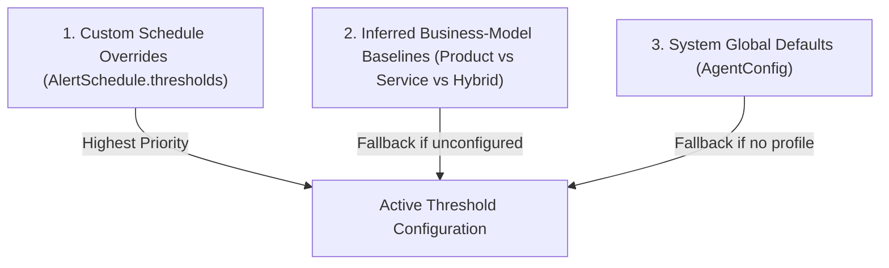

# Nexus AI Alerting System — Complete Technical Deep Dive

The **Nexus AI Alerting System** is an enterprise-grade, multi-tenant proactive monitoring engine that continuously evaluates financial, inventory, and operational metrics across Odoo instances. It combines **high-speed deterministic SQL pre-checks (Tier 1)** with **autonomous AI executive reasoning (Tier 2)** to detect anomalies, enforce business thresholds, and deliver decision-ready executive briefs without noisy false alarms.

---

## 🏛 1. High-Level Architecture & Execution Flow

```mermaid
flowchart TD
    Cron["Background Loop (AlertJobManager)"] -->|Poll due schedules| Due["Fetch Due AlertSchedule records"]
    Due --> Sem["Concurrency Semaphore (Limit 5)"]
    Sem --> RateLimit{"Check Daily Rate Limit<br/>(30 checks/24h)"}
    RateLimit -->|Exceeded| LogRate["Log Rate Limit Skip"]
    RateLimit -->|Allowed| Claim["Atomic DB Claim (Advance next_check_at)"]
    Claim --> Prechecks["Tier 1: Deterministic SQL Pre-Checks (alert_prechecks.py)"]
    
    Prechecks --> Eval{"Anomalies Found OR<br/>Custom Prompt?"}
    Eval -->|No (Clear Baseline)| SkipLLM["Skip Tier 2 LLM (Zero Token Cost) & Log OK"]
    Eval -->|Yes| Ctx["Context Serialization (serialize_alert_context)"]
    
    Ctx --> Tier2["Tier 2: LangChain AI Agent (CFO Persona)"]
    Tier2 --> Parse["Multi-layer Response Parsing (LlmAlertResult)"]
    Parse --> Dispatch{"Condition Triggered & Recipients?"}
    Dispatch -->|Yes| Email["Dispatch Executive Email (EmailService)"]
    Dispatch -->|No| LogComplete["Log Completed Result"]
    Email --> LogComplete
```

---

## ⚙️ 2. The Active Threshold Configuration

The **Active Threshold Configuration** is the dynamic, context-aware parameter set that dictates when financial or operational deviations warrant investigation.

### 2.1 The 3-Tier Precedence Resolution Hierarchy

Rather than relying on static global constants, thresholds are resolved per tenant and schedule via `resolve_effective_thresholds`:



1. **Tier 1: Schedule-Level Custom Overrides (`AlertSchedule.thresholds`)**
   - Stored directly on the schedule record as JSON (e.g., `{"cash_drop_pct": 10.0, "ar_overdue_ratio": 0.20}`).
   - Enables users to configure tighter bounds for sensitive schedules.
2. **Tier 2: Business-Model Dynamic Baselines (`BUSINESS_MODEL_BASELINES`)**
   - Automatically inferred by checking the tenant's profile (`get_tenant_profile_tool`):
     - **`product`** *(Retail, FMCG, Supermarket, E-commerce)*: Tighter cash margins (`12.0%` cash drop), strict AR collection (`15%` overdue ratio), active stock alerts (`15 units`), outlier multiplier `2.5x`.
     - **`service`** *(Consultancy, Legal, Agency, IT)*: Accommodates lumpy cash cycles (`35.0%` cash drop), looser collection cycles (`40%` overdue ratio), physical inventory pre-checks disabled (`low_stock_threshold: 0`), outlier multiplier `3.5x`.
     - **`hybrid`** *(Wholesale, Manufacturing, Contracting)*: Balanced thresholds (`20.0%` cash drop, `30%` AR overdue, `30%` revenue deviation, stock threshold `5 units`, `3.0x` multiplier).
3. **Tier 3: System Global Fallbacks (`AgentConfig`)**
   - Fallback system defaults defined in `AgentConfig` (`ALERT_CASH_DROP_PCT = 20.0`, `ALERT_AR_OVERDUE_RATIO = 0.30`, etc.).

---

### 2.2 Threshold Metrics & SQL Evaluation

| Parameter | Default | Evaluation Method & Logic |
| :--- | :--- | :--- |
| **`cash_drop_pct`** | `20.0%` | Compares 24h net cash movement (`asset_cash` in `fact_account_move_lines`) against 7-day average. Triggers if `recent < avg_7d * (1 - threshold/100)`. |
| **`ar_overdue_ratio`** | `0.30` (30%) | Computes `overdue_ar / total_ar` on posted `out_invoice` records in `fact_account_moves`. |
| **`revenue_deviation_pct`** | `30.0%` | Compares last 24h untaxed revenue against 30-day daily average from posted customer invoices. |
| **`low_stock_threshold`** | `5` units | Counts distinct products in `fact_stock_quants` where `(quantity - reserved_quantity) < threshold` (bypassed if `0`). |
| **`large_txn_multiplier`** | `3.0x` | Flags posted journal lines where `ABS(balance) > (avg_bal * multiplier)` per account type in the last 24h. |

---

### 2.3 Role in Grounding the AI Agent

When Tier 1 pre-checks trigger or when a custom prompt is provided, the resolved `thresholds` dictionary is passed into `serialize_alert_context` and embedded directly in `<alert_context_json>`.

This gives the AI agent full awareness of:
1. **The tenant identity and company scope**
2. **The user's original question/prompt**
3. **The active threshold configuration**
4. **The pre-check findings (if any)**

```xml
<alert_context_json>
{
  "tenant_id": "c7a192bc-5134-4b51-9e57-8cfb180db2e4",
  "company_ids": [1, 2],
  "prompt": "Monitor daily cash and revenue variances",
  "thresholds": {
    "cash_drop_pct": 12.0,
    "ar_overdue_ratio": 0.15,
    "revenue_deviation_pct": 20.0,
    "low_stock_threshold": 15.0,
    "large_txn_multiplier": 2.5
  },
  "precheck_summary": "• Cash inflow/balance dropped by 18.2% in recent period (threshold: 12.0%)."
}
</alert_context_json>
```

#### Why Active Threshold Awareness is Critical for the Agent:
- **Eliminates Subjective Hallucinations**: Prevents the LLM from arbitrarily declaring a 15% revenue swing as "healthy" or "alarming" without respecting company-specific bounds.
- **Accurate Severity Calibration**: The agent correlates findings against the threshold configuration to assign `CRITICAL`, `WARNING`, `OK`, or `INFO` severity under the `<severity_rubric>`.
- **Transparent Executive Citations**: Enables the agent to cite the exact threshold in its final brief (e.g., *"Cash dropped by 18.2%, breaching your configured 12.0% safety boundary for retail operations"*).

---

## 🔍 3. Tier 1: Deterministic SQL Pre-Checks Engine

Before invoking expensive LLM inference, `alert_prechecks.py` executes 8 high-performance SQL checks against the PostgreSQL analytical warehouse (`fact_` tables):

### 3.1 SQL Assertions Deep Dive

#### 1. Cash Flow Depletion (`check_cash_drop`)
Calculates trailing 7-day average cash movement vs. last 24 hours:
```sql
WITH cash_moves AS (
    SELECT
        m.date,
        SUM(l.balance) as daily_net
    FROM fact_account_move_lines l
    JOIN fact_account_moves m ON l.account_move_id = m.id
    WHERE 1=1 {tenant_filter}
      AND l.account_type = 'asset_cash'
      AND m.state = 'posted'
      {company_filter}
    GROUP BY m.date
),
stats AS (
    SELECT
        COALESCE(SUM(CASE WHEN date >= CURRENT_DATE - INTERVAL '1 day' THEN daily_net END), 0) as recent_cash,
        COALESCE(AVG(daily_net), 0) as avg_cash_7d
    FROM cash_moves
    WHERE date >= CURRENT_DATE - INTERVAL '7 days'
)
SELECT recent_cash, avg_cash_7d FROM stats;
```
- **Trigger**: `avg_7d > 0` and `recent_cash < avg_7d * (1 - threshold_pct / 100.0)`.

#### 2. Overdue Receivables (`check_overdue_ar`)
Evaluates proportion of unpaid customer invoices past their due date:
```sql
SELECT 
    COALESCE(SUM(amount_residual), 0) AS total_ar,
    COALESCE(SUM(CASE WHEN invoice_date_due < CURRENT_DATE THEN amount_residual ELSE 0 END), 0) AS overdue_ar
FROM fact_account_moves
WHERE 1=1 {tenant_filter}
  AND move_type = 'out_invoice'
  AND state = 'posted'
  AND payment_state IN ('not_paid', 'partial')
  {company_filter};
```
- **Trigger**: `total_ar > 0` and `(overdue_ar / total_ar) >= threshold_ratio`.

#### 3. Revenue Cliff Anomaly (`check_revenue_anomaly`)
Identifies severe revenue drops compared to 30-day baseline:
```sql
WITH daily_rev AS (
    SELECT
        date,
        SUM(amount_untaxed) as rev
    FROM fact_account_moves
    WHERE 1=1 {tenant_filter}
      AND move_type = 'out_invoice'
      AND state = 'posted'
      AND date >= CURRENT_DATE - INTERVAL '30 days'
      {company_filter}
    GROUP BY date
)
SELECT
    COALESCE(SUM(CASE WHEN date >= CURRENT_DATE - INTERVAL '1 day' THEN rev END), 0) as rev_24h,
    COALESCE(AVG(rev), 0) as avg_rev_30d
FROM daily_rev;
```
- **Trigger**: `avg_30d > 0`, `rev_24h < avg_30d`, and `((avg_30d - rev_24h) / avg_30d * 100.0) >= threshold_pct`.

#### 4. Duplicate Vendor Bills (`check_duplicate_invoices`)
Catches potential duplicate payments or invoicing errors:
```sql
SELECT partner_id, amount_total, date, COUNT(*) as cnt
FROM fact_account_moves
WHERE 1=1 {tenant_filter}
  AND move_type = 'in_invoice'
  AND state = 'posted'
  AND date >= CURRENT_DATE - INTERVAL '7 days'
  {company_filter}
GROUP BY partner_id, amount_total, date
HAVING COUNT(*) > 1;
```

#### 5. Inventory Stockout Risk (`check_low_inventory`)
Monitors physical inventory availability across warehouses:
```sql
SELECT COUNT(DISTINCT product_id) as low_stock_cnt
FROM fact_stock_quants
WHERE 1=1 {tenant_filter}
  AND (quantity - reserved_quantity) < :threshold
  {company_filter};
```
- **Note**: Completely skipped (returns `False, ""`) if `low_stock_threshold <= 0` (e.g. for service tenants).

#### 6. Outlier Transactions (`check_large_transactions`)
Identifies statistically abnormal journal lines exceeding account baseline multipliers:
```sql
WITH avg_by_type AS (
    SELECT account_type, AVG(ABS(balance)) as avg_bal
    FROM fact_account_move_lines l
    WHERE 1=1 {tenant_filter}
    GROUP BY account_type
)
SELECT COUNT(*) as large_cnt
FROM fact_account_move_lines l
JOIN fact_account_moves m ON l.account_move_id = m.id
JOIN avg_by_type a ON l.account_type = a.account_type
WHERE 1=1 {tenant_filter}
  AND m.state = 'posted'
  AND m.date >= CURRENT_DATE - INTERVAL '1 day'
  AND ABS(l.balance) > (a.avg_bal * :multiplier)
  AND a.avg_bal > 100
  {company_filter};
```

#### 7. Unbalanced Journal Entries (`check_unbalanced_journals`)
Deterministic accounting audit check that triggers immediate **CRITICAL** severity:
```sql
SELECT COUNT(DISTINCT m.id) as unbalanced_cnt
FROM fact_account_move_lines l
JOIN fact_account_moves m ON l.account_move_id = m.id
WHERE 1=1 {tenant_filter} AND m.state = 'posted' {company_filter}
GROUP BY m.id
HAVING ABS(SUM(l.debit) - SUM(l.credit)) > 0.01;
```

#### 8. Suspicious Weekend Postings (`check_weekend_postings`)
Detects journal movements executed outside normal business hours:
```sql
SELECT COUNT(*) as weekend_cnt
FROM fact_account_moves m
WHERE 1=1 {tenant_filter} AND m.state = 'posted'
  AND m.date >= CURRENT_DATE - INTERVAL '7 days'
  AND EXTRACT(ISODOW FROM m.date) IN (6, 7)
  {company_filter};
```

---

### 3.2 Pre-Check Aggregation & Severity Ranking
In `run_all_prechecks`:
- Checks are iterated and summarized with bullet points (`• ...`).
- Severity is ranked: `critical` (Rank 3) > `warning` (Rank 2) > `info` (Rank 0).
- `unbalanced_journals` defaults to `critical`; other checks default to `warning` unless specified otherwise.
- Returns:
  ```python
  {
      "any_triggered": bool,
      "triggered_checks": List[str],
      "precheck_summary": str,
      "highest_severity": str,
  }
  ```

---

## 🤖 4. Tier 2: AI Agent Executive Reasoning (LangChain + Claude)

If pre-checks detect anomalies or a custom prompt is defined, the job invokes `DoovaLangChainAgent`.

### 4.1 Strict Prompt Structure & Output Protocol
The system builds a structured prompt containing:
- `<role>`: Senior executive business advisor / Virtual CFO.
- `<alert_context_json>`: Tenant, companies, prompt, and active thresholds.
- `<deterministic_precheck_findings>`: SQL summary.
- `<grounding_rules>`: Anti-hallucination rules requiring strict data grounding.
- `<severity_rubric>`: Deterministic severity assignment (`CRITICAL`, `WARNING`, `OK`, `INFO`).
- `<output_format>`: Enforces clean executive brief with required sections and trailing JSON block:

```json
```json
{
  "condition_triggered": true,
  "severity": "warning",
  "summary": "Cash balance dropped by 18.2% breaching the 12.0% retail threshold.",
  "confidence": "high"
}
```
```

### 4.2 Multi-Layered Robust Response Parsing
The response is parsed through 4 resilient layers in `_parse_llm_response`:
1. **Layer 1 (Pydantic Deserialization)**: Extracts and validates the JSON block using `LlmAlertResult.model_validate_json(...)`.
2. **Layer 2 (Explicit Severity Prefix)**: Regex scan on beginning of output (`CRITICAL:`, `WARNING:`, `INFO:`, `OK:`).
3. **Layer 3 (Strategic Recommendation Search)**: Inspects `## STRATEGIC RECOMMENDATION` section for severity keywords.
4. **Layer 4 (Safe Fallback Default)**: Defaults to `"info"` severity and `condition_triggered = False` preventing runtime crashes.

---

## 🗄 5. Database Schema & Data Models

### 5.1 `AlertSchedule` (`alert_schedules`)
| Field | Type | Description |
| :--- | :--- | :--- |
| `id` | `UUIDField` | Primary key (UUID v4). |
| `tenant` | `ForeignKey(Tenant, null=True)` | Owner tenant. Null indicates system-wide schedule. |
| `tenants` | `JSONField` | List of target tenant UUID strings for multi-tenant schedules. |
| `name` | `CharField(200)` | Descriptive name (e.g. `'Daily Activity Alert'`). |
| `prompt` | `TextField` | User-defined prompt or monitoring instructions. |
| `recipients` | `JSONField` | Array of recipient email strings (`["cfo@company.com"]`). |
| `companies` | `JSONField` | Array of Odoo company IDs (`[1, 2]` or `[]` for all). |
| `thresholds` | `JSONField` | Custom threshold overrides (`{"cash_drop_pct": 15.0}`). |
| `webhook_url` | `CharField(500)` | Slack, MS Teams, or custom HTTP Webhook endpoint. |
| `timezone` | `CharField(60)` | Timezone identifier (default `'UTC'`). |
| `is_enabled` | `BooleanField` | Active/Inactive toggle. |
| `is_system_default` | `BooleanField` | If True, automatically executes across all tenants. |
| `next_check_at` | `DateTimeField` | Timestamp for the next scheduled execution. |
| `last_checked_at` | `DateTimeField` | Timestamp of the most recent execution. |
| `created_at` / `updated_at` | `DateTimeField` | Auto-managed audit timestamps. |

### 5.2 `AlertLog` (`alert_logs`)
| Field | Type | Description |
| :--- | :--- | :--- |
| `id` | `BigAutoField` | Primary key. |
| `schedule` | `ForeignKey(AlertSchedule)` | Associated schedule. |
| `tenant` | `ForeignKey(Tenant)` | Denormalized tenant relation for fast tenant-scoped log queries. |
| `status` | `CharField(10)` | `'completed'` or `'failed'`. |
| `condition_triggered` | `BooleanField` | True if anomalies or breaches were detected (db column `has_anomalies`). |
| `summary` | `TextField` | AI-generated executive summary brief. |
| `alert_sent` | `BooleanField` | True if notification email/webhook was dispatched. |
| `error_message` | `TextField` | Error traceback or explanation if status is `'failed'`. |
| `checked_at` | `DateTimeField` | Auto timestamp of execution. |

---

## 🌐 6. REST API Specification (`/api/v1/alerts`)

All routes enforce role-based access control (RBAC):
- Read operations require `view_alerts` permission.
- Write/Execute operations require `manage_alerts` permission.

| Method | Endpoint | Summary & Behavior |
| :--- | :--- | :--- |
| `POST` | `/alerts/schedules` | Creates schedule. Validates emails and normalizes `start_at` to UTC. |
| `GET` | `/alerts/schedules` | Lists schedules for current tenant, multi-tenant matches, and system defaults. Supports `limit` & `offset`. |
| `PATCH` | `/alerts/schedules/{id}` | Updates specific fields (`name`, `prompt`, `recipients`, `companies`, `thresholds`, `webhook_url`, `is_enabled`, `next_check_at`). |
| `DELETE`| `/alerts/schedules/{id}` | Deletes schedule with tenant ownership verification. |
| `POST` | `/alerts/schedules/{id}/run-now` | Triggers instant execution. Enforces a 60-second cooldown per schedule. |
| `GET` | `/alerts/history` | Lists execution history (`AlertLog` records) for tenant. |
| `GET` | `/alerts/ops/metrics` | Returns operational health metrics in `json` or Prometheus format. |

---

## 📬 7. Multichannel Delivery & Operational Controls

### 7.1 Email Dispatch (`EmailService`)
- Formats executive-grade HTML briefs with severity badges:
  - **Critical**: `#dc2626` (Red header, `HIGH` email priority)
  - **Warning**: `#d97706` (Amber header, `HIGH` email priority)
  - **Info**: `#2563eb` (Blue header, `NORMAL` email priority)
  - **OK / Success**: `#16a34a` (Green header, `NORMAL` email priority)
- Includes tenant context, generation timestamps, and clean typography.
- Retries delivery up to 3 times before recording failure.

### 7.2 Webhook Integration
- When `schedule.webhook_url` is configured, dispatches formatted JSON payloads compatible with Slack, MS Teams, and custom endpoints via `httpx.AsyncClient`.
- Color codes attachments (`#e74c3c` for anomalies, `#2ecc71` for normal checks).

### 7.3 Concurrency, Rate Limiting, & Atomic Claiming
- **Daily Rate Limiting**: Maximum 30 AI alert checks per tenant in a rolling 24-hour window (`MAX_DAILY_ALERT_CHECKS_PER_TENANT`).
- **Instant Run Cooldown**: 60-second delay between on-demand runs (`RUN_NOW_COOLDOWN_SECONDS`).
- **Concurrency Limiter**: `asyncio.Semaphore(5)` throttles concurrent workers to prevent database overload.
- **Atomic Schedule Claiming**: Workers atomically claim schedules using:
  ```python
  AlertSchedule.objects.filter(
      id=schedule.id,
      next_check_at=schedule.next_check_at
  ).update(
      next_check_at=now + timedelta(days=1),
      last_checked_at=now
  )
  ```
  Prevents duplicate executions across distributed background processes.

---

## 📊 8. Observability & Prometheus Metrics

The `AgentMetricsRegistry` exposes real-time operational telemetry:

| Metric Name | Type | Description |
| :--- | :--- | :--- |
| `nexus_alerts_triggered_total` | Counter | Total alert checks evaluated. |
| `nexus_alerts_sent_total` | Counter | Total alert notifications dispatched. |
| `nexus_alerts_failed_total` | Counter | Total check execution failures. |
| `nexus_prechecks_skipped_llm_total` | Counter | Tier 1 SQL pre-checks that completed with normal baselines, skipping LLM costs. |
| `nexus_rate_limit_blocks_total` | Counter | Requests throttled by the 24-hour rate limiter. |
| `nexus_reports_generated_total` | Counter | Total scheduled reports created. |
| `estimated_llm_cost_saved_usd` | Gauge (JSON) | Calculated as `prechecks_skipped_llm_total * $0.15`. |
